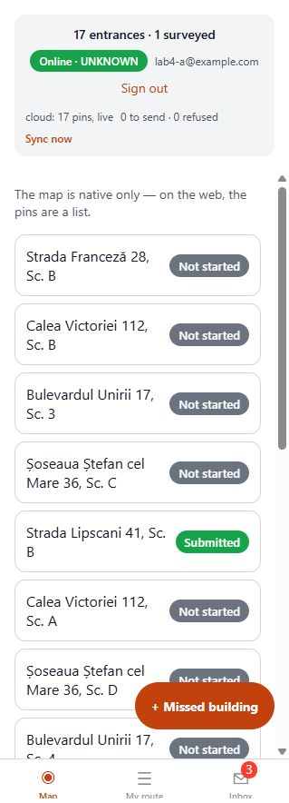
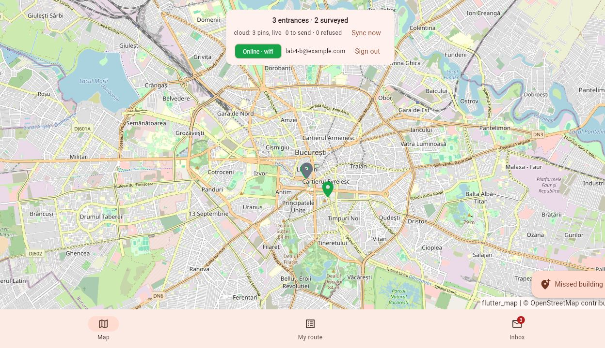

# Lab 4 verification

Firebase project: `field-app-rebeca-sync`. Storage route: **B**, local emulator.
No billing was enabled.

## Checks completed

- Expo TypeScript: passed.
- Expo ESLint: no errors; the contract's existing schema/type name warnings
  remain when running without `--quiet`.
- Flutter analysis: only the three existing enum naming informational messages.
- Flutter web release build: passed.
- Five Drift database tests: passed, using the Windows system SQLite library
  temporarily for this test run. The package's bundled Windows DLL download was
  unavailable; the application configuration was restored after the test.
- Real Firebase: sign-in for A and B; 20 pins seeded; live reassignment;
  unauthorized reads and updates refused; idempotent survey write;
  stale assignment write refused. All passed.
- Local Firebase emulators: the same checks, plus photo upload and denial of
  cross-user Storage writes. All passed.
- Expo web: signed in as A, submitted a survey and returned to its saved data.
- Flutter web: signed in as B and submitted a survey.
- Both web sessions survived a page reload. A real office reassignment moved a
  pin from Expo A (18 -> 17 pins) to Flutter B (2 -> 3 pins) without reloading
  either application.

The dedicated smoke accounts use `example.com` addresses. No personal password
or private configuration is included in these screenshots or in the repository.

## Windows build note

The GitHub release download endpoint returned an unavailable response for
SQLite's precompiled binaries. An Android x64 copy already cached by Lab 3 was
verified against the package's SHA-256 before reuse. No checksum check was
disabled. Android validation below targets the Pixel 7 x64 emulator.

## Review

This is a solo submission. Automated checks and implementation notes do not
constitute a partner's review comment. The course's review requirement still
needs the instructor's solo-team policy to be applied.
